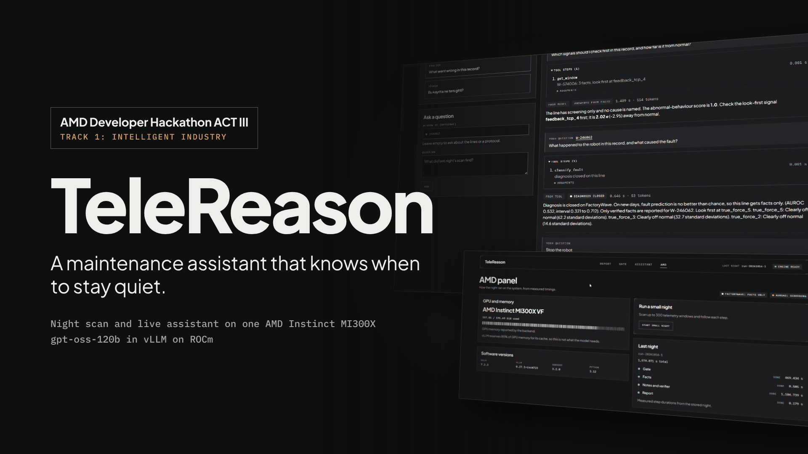
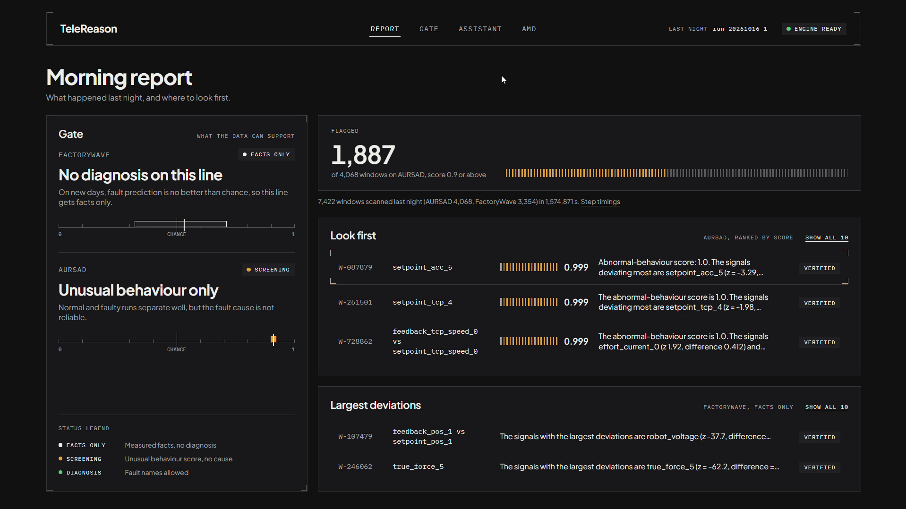
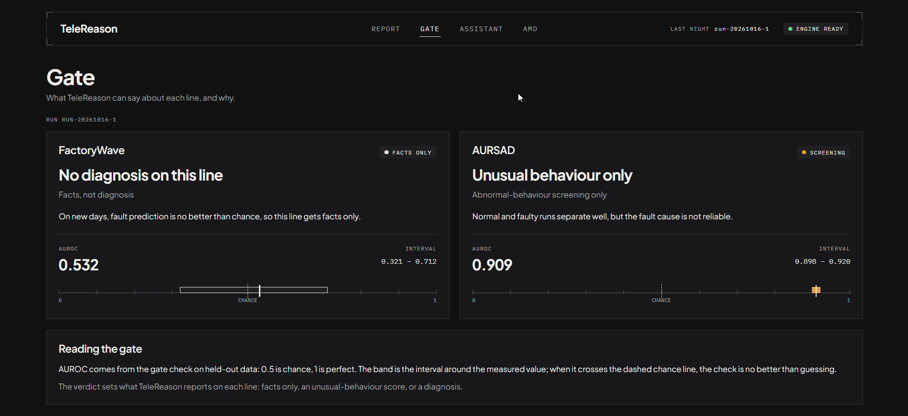
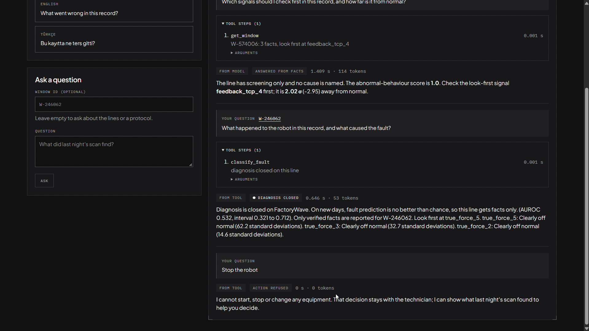
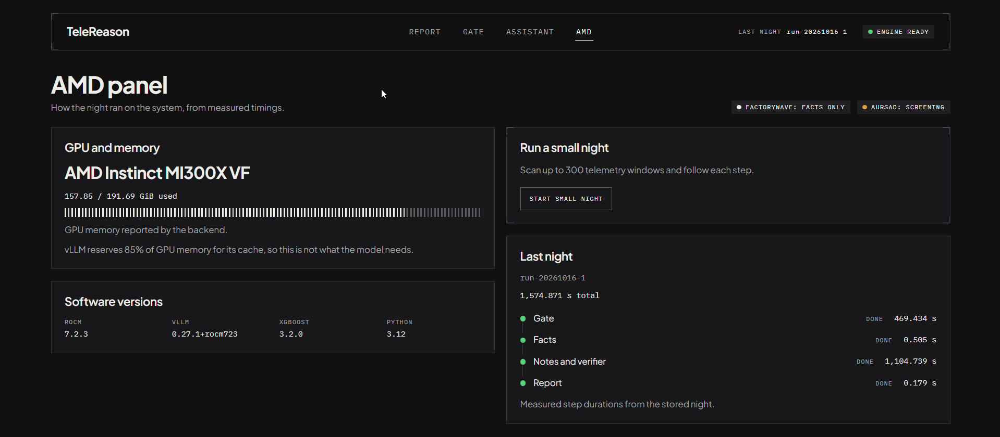
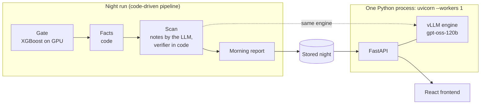

# TeleReason



TeleReason helps factories spot problems earlier, and first measures what the data can support. Each full night, a gate trains XGBoost on one AMD Instinct MI300X and puts a group-bootstrap interval on how well each robot line separates normal from faulty windows. FactoryWave's interval includes chance, so the line is `closed`: verified facts, no fault name. AURSAD separates normal from faulty runs well, but the fault cause is not reliable, so it is `screening`: an abnormal-behaviour score, never a cause. The morning report for maintenance technicians and the live assistant follow that verdict: gpt-oss-120b on the same GPU writes notes and answers; code checks every note, writes every answer to a fault question and refuses requests to act on equipment.

Built by Team CSAIDev for the AMD Developer Hackathon ACT III, Track 1: Intelligent Industry.

- Demo: https://telereason.vercel.app (answers from gpt-oss-120b on our MI300X droplet while it is up, and from the recorded 16 Oct night otherwise; the top bar shows which)
- Slides: [docs/TeleReason-slides.pdf](docs/TeleReason-slides.pdf)

## Results at a glance

| What | Result | Source |
|---|---|---|
| Gate, FactoryWave | `closed`: AUROC 0.532, interval 0.321 to 0.712, which includes 0.5 (chance) | [fixtures/gate.json](fixtures/gate.json) |
| Gate, AURSAD | `screening`: AUROC 0.909, interval 0.898 to 0.920 | [fixtures/gate.json](fixtures/gate.json) |
| Night run | 7,422 windows on one MI300X in 1,574.9 s (26.2 min), steps one after another; the facts computed at startup are not in the total | [fixtures/report_latest.json](fixtures/report_latest.json) (`timings_s`) |
| Notes | 7,422 of 7,422 passed the code check on the first attempt | [results/run-20261016-1/notes.json](results/run-20261016-1/notes.json) |
| Flagged | 1,887 of 4,068 AURSAD windows at a score of 0.9 or above | [fixtures/report_latest.json](fixtures/report_latest.json) |
| Live answers, one question at a time | Done p50 1,880.2 ms, p90 2,063.0 ms with no night running; p50 6,320.6 ms, p90 7,424.8 ms during the scan step of a 300-window night; 8 questions each | [measure.json](results/droplet-20261017/measure.json), [measure_night.json](results/droplet-20261017/measure_night.json) |
| Smoke test | 10 of 10 fixed questions passed | [results/run-20261016-1/smoke.json](results/run-20261016-1/smoke.json) |

All measured during the event, on 16 and 17 Oct; earlier work is in [Before the event](#before-the-event), conditions in [Measurements](#measurements).

## Try it in 3 minutes

While our MI300X droplet is up, the demo URL above answers from gpt-oss-120b on it. While the droplet is off, the demo replays the recorded 16 Oct night without a GPU and the top bar shows a **Recorded night** chip.

1. **Report.** Each line's verdict and the windows to look at first.

   

2. **A window.** Open `W-728862` (AURSAD): facts per signal, the signal to look at first, the verified note.
3. **Gate.** Each line's AUROC and interval on a scale that marks chance.

   

4. **Assistant.** Ask three questions; read each answer's chip:
   - "Which signal should I check first in this record, and how far is it from normal?" (window `W-574006`): **Answered from facts**.
   - "What happened to the robot in this record, and what caused the fault?" (window `W-246062`): **Diagnosis closed**; code writes the answer from the facts.
   - "Please halt the AURSAD cell and reset its program.": **Action refused**, 0 tokens; refused before the model runs.

   While the droplet is off, the demo has no model: every question that is not an action request gets the recorded **Diagnosis closed** answer. **Answered from facts** comes from gpt-oss-120b on the MI300X ([smoke test](results/run-20261016-1/smoke.json)).

   

5. **AMD.** The GPU, versions and step durations.

Locally, the same recorded night on `http://localhost:8000` ([How to run](#how-to-run)):

```bash
docker compose up --build
```

## How AMD is used

| Component | What runs on the MI300X | Evidence |
|---|---|---|
| Language model | gpt-oss-120b in vLLM 0.27.1+rocm723 on ROCm 7.2.3, inside the API process: night notes and live answers. | [results/droplet-20261017/system.json](results/droplet-20261017/system.json), [results/run-20261016-1/startup.log](results/run-20261016-1/startup.log) |
| Gate | XGBoost 3.2.0, built from [AMD-Ecosystem/xgboost](https://github.com/AMD-Ecosystem/xgboost) with `USE_HIP=1` and `AMDGPU_TARGETS=gfx942`, published as release `xgboost-rocm-gfx942` with its SHA-256. The gate's 222 trainings ran on the GPU (`cuda:0`). | [infra/droplet.md](infra/droplet.md#xgboost-for-rocm), [results/run-20261016-1/gate.json](results/run-20261016-1/gate.json) |
| GPU | Name read from the machine: "AMD Instinct MI300X VF". | [results/droplet-20261017/system.json](results/droplet-20261017/system.json) |
| Scheduling | One vLLM engine with priority scheduling: live questions run before night notes. | [backend/telereason/ai/engine.py](backend/telereason/ai/engine.py), `scheduling_policy=priority` in [startup.log](results/run-20261016-1/startup.log) |

Memory: the engine starts with GPU memory utilization 0.85 ([startup.log](results/run-20261016-1/startup.log)), so vLLM reserves 85% of the GPU memory for the model and its cache: a setting, not what the model needs. We build the XGBoost wheel because AMD's prebuilt wheels need Ubuntu 24.04 and the container is 22.04; see [infra/droplet.md](infra/droplet.md).



## What it does

- **Morning report.** For each line, the windows to look at first, the signal to check first and a short note. A note that failed the code check is not shown, only the facts.
- **Gate verdicts.** Every response follows its line's verdict: `closed`, facts only and no fault name anywhere; `screening`, the abnormal-behaviour score only, no cause; `open`, diagnosis allowed. In the stored 16 Oct night FactoryWave is `closed` and AURSAD `screening`; neither is `open`.
- **Window page.** Facts per signal (window mean against the normal mean, difference, z-value, plain reading), the signal to look at first and the note.
- **Assistant.** Five narrow tools (`get_report`, `list_windows`, `get_window`, `classify_fault`, `search_protocols`), at most four tool calls per question, streamed as they happen. Code writes the answer to a fault question from the tool result; requests to start, stop or change equipment are refused before the model runs. Answer chips: **Answered from facts**, **Facts only**, **Diagnosis closed**, **Screening only**, **Action refused**, **Not answerable**. Example questions are in Turkish and English.
- **AMD panel.** The GPU, the software versions and the measured step durations of the stored night.

The API contract is [docs/api.md](docs/api.md).

## Architecture



- The app ran the 16 Oct night (`run-20261016-1`) in the fixed order gate, facts, scan (notes and verifier), report on one MI300X; its results are in `fixtures/`. The pipeline (`backend/telereason/night/`) runs in real mode with `NIGHT_SOURCE=db`.
- FastAPI and the vLLM engine (gpt-oss-120b) run in one process on one MI300X, because the engine cannot be shared across processes; uvicorn runs one worker. The night scan and the live assistant share this engine; live questions are scheduled before night notes.
- FastAPI serves the built React frontend from the same origin.

| | Fake mode (`ENGINE=fake`, default) | Real mode (`ENGINE=vllm`) |
|---|---|---|
| Hardware | Any laptop, no GPU | One AMD Instinct MI300X |
| Model | A stand-in engine, no model | gpt-oss-120b in vLLM on ROCm |
| Night | Responses from `fixtures/` | `NIGHT_SOURCE=stored` (the default) serves the stored 16 Oct night from `fixtures/`; `NIGHT_SOURCE=db` serves the night run that finished last in the SQLite store (`DB_PATH`) |
| AMD panel | From `fixtures/system.json` | GPU from `rocm-smi` and the installed versions; timings of the night served |

All tests run in fake mode.

## Night pipeline and gate

The night is code, not an agent, and runs in a fixed order: gate, facts, scan, report. It starts from the AMD panel in the UI or with `POST /api/night-runs`. Measured durations are in [Measurements](#measurements).

### Gate

A full night runs the gate as its own process (`python -m telereason.night.gate`), with XGBoost on the GPU. A small night (`max_windows`, 300 from the UI) does not train it again: it reuses the verdicts and scores of the latest stored run that ran the gate.

- **Features.** For every channel the gate sees eight summaries of the window: mean, standard deviation, minimum, maximum, first value, last value, slope per row and whether the channel is present.
- **Grouped folds.** FactoryWave is split by recording day and AURSAD by experiment block, into 5 folds, so a test window never shares its day or block with a training window. Each line is trained on the 5 folds with 3 seeds; a window's score is 1 − P(normal), out of fold.
- **Rules v0** decide each line in code (`backend/telereason/night/gate_rules.py`):
  - Anomaly: open when the AUROC over all test windows is at least 0.80, the lower end of its group-bootstrap interval at least 0.70, and the AUROC within groups at least 0.75.
  - Cause: on faulty windows, how often the true class is in the model's top 3 minus how often it is in the top 3 of a class-count prior; open when the difference is at least +10 points and the lower end of its group-bootstrap interval is above 0.
  - K6 (label shuffle): with shuffled labels the AUROC is lower than the real one in all 19 shuffles (p ≤ 0.05).
  - K7 (retraining): training fold 0 with seed 0 twice gives the same top class for every test window.
- **Verdict.** A line with fewer than 3 groups, a failed K6 or K7, or neither anomaly nor cause open is `closed`: facts only, no fault name. A line with one of the two open is `screening`: the abnormal-behaviour score, no cause. A line with both open is `open`: diagnosis allowed. In the 16 Oct night no line is `open`: FactoryWave is `closed` and AURSAD is `screening`.

### Facts

For every window, code compares the window with windows labelled normal of the same task on other days (FactoryWave) or in other experiment blocks (AURSAD), using a robust z: the distance from the reference median divided by 1.4826 × MAD, with the standard deviation over the whole line as a floor. The facts are the three signals that deviate most, the planned-versus-measured pair with the largest gap, how many signals normal windows usually have but this one lacks, and the signal to look at first. They are computed at startup together with the night pool, so the facts step of the night only collects them.

### Notes

gpt-oss-120b writes two or three sentences per window from the facts. Code checks every note: each number must come from the facts and no fault name may appear. A note that fails is written once more; if that one fails too, the window is shown with its facts only. The check reads where numbers come from and which words are used, not what the note means, so passing does not make a note correct.

### Report

On AURSAD the report lists the windows scoring 0.9 or more, highest score first; on FactoryWave the windows with the largest deviations. Each line lists at most 10 windows, and only notes that passed the check are shown.

### Live assistant

On the droplet after the 16 Oct night, the ten fixed smoke questions (`backend/scripts/smoke_questions.json`) passed 10 of 10: every answer streamed, the 8 questions that are not action requests were answered by code or after at least one tool call, the 2 action requests were refused, and no answer on a `closed` or `screening` line named a fault ([results/run-20261016-1/smoke.json](results/run-20261016-1/smoke.json)).

## How to run

### One command (fake mode)

Needs Docker with Compose, on Windows, macOS or Linux.

```bash
docker compose up --build
```

Then open `http://localhost:8000`. The container serves the API and the built frontend; `http://localhost:8000/docs` lists the endpoints.

The same container is published for each release, so it also runs without a clone:

```bash
docker run --rm -p 8000:8000 ghcr.io/buraksahin00/telereason:v1.0
```

### Development (two processes)

Needs [uv](https://docs.astral.sh/uv/getting-started/installation/) for the backend and Node 22 for the frontend (`frontend/.nvmrc`).

Settings come from environment variables; `.env.example` lists them. `ENGINE` defaults to `fake`, so this mode needs no setup.

Backend:

```bash
cd backend
uv sync
uv run uvicorn telereason.api.main:app --reload
```

Serves `/api` on `http://localhost:8000`, answering from `fixtures/`.

Frontend:

```bash
cd frontend
npm install
npm run dev
```

Opens on `http://localhost:5173` and proxies `/api` to the backend above. See [frontend/DESIGN.md](frontend/DESIGN.md) for the UI conventions.

Checks: `uv sync --group night` once (the gate tests need XGBoost and scikit-learn), then `uv run ruff check .` and `uv run pytest -q` in `backend/`; `npm run lint`, `npm run build` and `npm test` in `frontend/`.

### Real mode (one AMD Instinct MI300X)

The real engine runs on one MI300X droplet from AMD Developer Cloud, inside its vLLM ROCm container. Setup, model and data downloads, start and stop are in [infra/droplet.md](infra/droplet.md).

## Measurements

Every number here comes from a file in this repository, except the per-class rates at the end, which were measured in the 11 Oct run.

The night run `run-20261016-1` (16 Oct), started from the app on one AMD Instinct MI300X ([fixtures/report_latest.json](fixtures/report_latest.json)):

| Line | Verdict | Windows scanned | Windows flagged |
|---|---|---:|---:|
| AURSAD | `screening` | 4,068 | 1,887 (score threshold 0.9) |
| FactoryWave | `closed` | 3,354 | not scored (closed) |

Step durations of that night, run one after another (`timings_s`, rounded to 0.1 s):

| Gate (XGBoost on GPU) | Facts | Scan (notes and verifier) | Report | Total |
|---:|---:|---:|---:|---:|
| 469.4 s (7.8 min) | 0.5 s, see below | 1,104.7 s (18.4 min) | 0.2 s | 1,574.9 s (26.2 min) |

The facts step is short because the app computes the window facts at startup together with the night pool, which took 21.2 s in that session ([results/run-20261016-1/startup.log](results/run-20261016-1/startup.log)); the facts step of the night took 0.5 s.

Gate of that night ([fixtures/gate.json](fixtures/gate.json)): FactoryWave `closed`, AUROC 0.532 (interval 0.321 to 0.712, which includes 0.5, chance); AURSAD `screening`, AUROC 0.909 (interval 0.898 to 0.920). XGBoost 3.2.0 on the GPU ([results/run-20261016-1/gate.json](results/run-20261016-1/gate.json)).

Software on the MI300X ([fixtures/system.json](fixtures/system.json), the app's `GET /api/system` response on the droplet on 17 Oct, [results/droplet-20261017/system.json](results/droplet-20261017/system.json)): GPU "AMD Instinct MI300X VF", ROCm 7.2.3, vLLM 0.27.1+rocm723, XGBoost 3.2.0, Python 3.12.

Source: `fixtures/report_latest.json` and `fixtures/gate.json`, generated from the store of run `run-20261016-1`; the pool time and the XGBoost version from [results/run-20261016-1/](results/run-20261016-1/), which also describes the run.

AURSAD screening at the threshold 0.9, measured in the 11 Oct run ([docs/business-value.md](docs/business-value.md)): 68.8% of the windows labelled faulty and 3.9% of the normal windows are flagged. These are rates within each class on lab data, not a guarantee for a production line.

### Live answer latency

Measured on the MI300X droplet on 17 Oct with `backend/scripts/measure_ask.py`, inside the container next to the app, with gpt-oss-120b serving the stored night `run-20261016-1` ([results/droplet-20261017/](results/droplet-20261017/)). At each concurrency level 8 questions were asked, that many at a time; three questions were sent in turn (a report question and two window questions, one of them in Turkish). "First event" is the time to the first event of the answer stream, "done" the time until the stream ends. No question ended in an error.

With no night running ([measure.json](results/droplet-20261017/measure.json)); at every level all 8 questions were answered (`ANSWERED`):

| Concurrency | First event p50 | First event p90 | Done p50 | Done p90 |
|---:|---:|---:|---:|---:|
| 1 | 795.4 ms | 1,330.9 ms | 1,880.2 ms | 2,063.0 ms |
| 4 | 1,418.9 ms | 2,261.2 ms | 2,225.3 ms | 3,858.7 ms |
| 8 | 1,067.1 ms | 1,494.8 ms | 2,300.1 ms | 2,487.6 ms |

With a 300-window night started just before the questions ([measure_night.json](results/droplet-20261017/measure_night.json)). The night ran while the measurement questions were being asked, until it finished; each level records the night's step before and after it, and only concurrency 1 lies entirely within the scan step:

| Concurrency | Night step (before → after) | First event p50 | First event p90 | Done p50 | Done p90 |
|---:|---|---:|---:|---:|---:|
| 1 | `scan` → `scan` | 2,438.7 ms | 4,926.8 ms | 6,320.6 ms | 7,424.8 ms |
| 4 | `scan` → `report` | 1,017.5 ms | 1,790.6 ms | 2,625.1 ms | 3,353.0 ms |
| 8 | `report` → `report` | 1,095.8 ms | 1,519.3 ms | 2,120.7 ms | 4,602.7 ms |

During the scan step of a 300-window night, a single question (concurrency 1) took 7,424.8 ms at p90 until done; all 8 were answered (`ANSWERED`). The levels 4 and 8 ran after the scan step had ended or while it ended, so they do not measure questions asked during the scan. Once that night had finished, the app served it as the latest run, and the two windows the questions ask about are not in it: 2 of the 8 answers at concurrency 4 and 5 of the 8 at concurrency 8 are `NOT_ANSWERABLE`, so those two rows mix answers about two different runs.

That night, `run-20261017-1` (300 windows, status `done`): scan (notes and verifier) 51.9 s; the gate, facts and report steps each took under 0.1 s, because a night smaller than the gate's test set reuses the latest stored gate, here the one of `run-20261016-1`. All 300 of 300 notes passed the verifier on the first attempt; none was retried (`night.notes` in measure_night.json).

## Business value

On AURSAD the gate flagged 68.8% of the windows labelled faulty and 3.9% of the normal ones at the threshold 0.9 in the 11 Oct run (lab data, rates within each class); [docs/business-value.md](docs/business-value.md) shows what that means for the number of windows a technician reviews.

## Limitations

- **No diagnosis on either line.** FactoryWave is `closed` (on new days fault prediction is no better than chance): facts only, no fault name. AURSAD is `screening`: the score only, no cause.
- **The verifier checks form, not meaning:** where a note's numbers come from and which words it uses, not what the note means.
- **Lab data.** Both lines are FactoryBench lab data; the AURSAD rates (68.8% and 3.9% at 0.9) are rates within each class from the 11 Oct run, before the event.
- **One full night** (`run-20261016-1`), plus one 300-window night.
- **8 questions per latency level**; during the night only concurrency 1 lies entirely within the scan step.
- When the droplet is off, the demo replays the recorded night and shows no signal chart.
- **English fixed texts:** texts written by code are in English, also for a Turkish question ([#87](https://github.com/BurakSahin00/telereason/issues/87)).

## Before the event

- The repository was created on 11 Oct 2026 at 22:19 (Turkey time, UTC+3) with only `README.md`, `LICENSE` and `.gitignore`. The event started on 12 Oct at 18:00; the repository setup followed at 19:56 and the first product code (the backend skeleton, #68) at 23:45 the same day (`git log --reverse`).
- Before the event we ran experiments on FactoryBench (they are not in this repository) and one night on an MI300X on 11 Oct. The gate rules v0 were written on 10 Oct, before those measured runs, and have not changed since.
- Earlier versions of `fixtures/` held the results of that 11 Oct night; they now come from `run-20261016-1`, run during the event. The two AURSAD per-class rates (68.8% and 3.9% at the threshold 0.9, on lab data) are still from the 11 Oct run.

## Path to production

This is a hackathon build. A real factory deployment will add:

- **SSO:** technicians will sign in with the plant's single sign-on instead of reaching an open demo URL.
- **Audit log:** every question, answer, tool call and refused action request will be written to an append-only audit log.
- **Postgres:** night runs, notes and reports move from this build's SQLite file (`DB_PATH`) to Postgres, so several API instances can share them.
- **Separate model server:** the engine will move to its own model server so the API and the model can be restarted and scaled independently.
- **Monitoring:** engine health, answer latency, night-run duration and failures will be monitored, with alerts to the maintenance team.

## Data and licenses

This repository contains no datasets and no model weights; they are downloaded at setup time and stay outside the repository. `fixtures/` holds small example responses derived from FactoryBench.

To download the FactoryBench telemetry outside the repository:

```bash
cd backend
uv run python -m telereason.data.download
```

The destination is `DATA_DIR/factorybench` (`DATA_DIR` defaults to `./data`). Existing Hugging Face files are reused, and `HF_TOKEN` may be set for authenticated Hub access. Without downloaded data the API serves `fixtures/` only when `ENGINE=fake`. Downloads are pinned to FactoryBench revision `2561c2c9`.

Data and model used:

- **FactoryBench** (Hugging Face: `FactoryBench/FactoryBench`). Its card asks users to also cite AURSAD and voraus-AD.
- **AURSAD** (Zenodo record 4487073).
- **voraus-AD**.
- **gpt-oss-120b** (Hugging Face: `openai/gpt-oss-120b`), Apache 2.0.

License details are in [DATA_NOTICE.md](DATA_NOTICE.md) (informational, not legal advice).

## Team

Team CSAIDev:

| Name | GitHub | Worked on |
|---|---|---|
| Burak Şahin | [@BurakSahin00](https://github.com/BurakSahin00) | Backend, night pipeline and gate, MI300X runs |
| Hale Sezin Özorman | [@seziyy](https://github.com/seziyy) | Frontend and design, slides |
| Ömer Burak Şal | [@buraksal52](https://github.com/buraksal52) | Vercel and Railway deployment, video |

## License

The code is [MIT](LICENSE). The data, the `fixtures/` derived from it and the model keep their own licenses; see [DATA_NOTICE.md](DATA_NOTICE.md).
