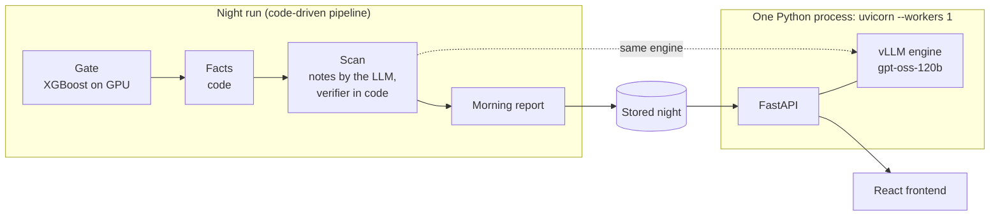

# TeleReason

TeleReason helps factories spot problems earlier. Overnight it scans robot-cell telemetry on one AMD Instinct MI300X and writes a morning report for maintenance technicians; a nightly gate checks what the data supports, so it reports verified facts, not guesses. During the day a live assistant answers technicians' questions from the same night, finds maintenance protocols and refuses requests to act on equipment.

Built by Team CSAIDev for the AMD Developer Hackathon ACT III, Track 1: Intelligent Industry.

- Demo: to be added
- Video: to be added

## What it does

- **Morning report.** One section per line with the windows a technician should look at first, the signal to check first and a short note. Every note is checked by code against the facts; a note that did not pass is not shown, only the facts.
- **Gate verdicts.** Each night the gate decides what the data of each line can support, and every response follows that verdict:
  - `closed`: no diagnosis, facts only. No fault name appears anywhere.
  - `screening`: the abnormal-behaviour score only, no cause.
  - `open`: diagnosis allowed.

  In the stored 16 Oct night, FactoryWave is `closed` (facts, not diagnosis) and AURSAD is `screening` (abnormal-behaviour screening only, no cause). Neither line is `open`.
- **Window page.** For one window: the facts per signal (window mean against the normal mean, the difference, the z-value and a plain reading), the signal to look at first, and the note with whether it passed the verifier.
- **Assistant.** A tool-calling assistant over five narrow tools (`get_report`, `list_windows`, `get_window`, `classify_fault`, `search_protocols`), at most four tool calls per question. The answer streams the tool calls as they happen. On a fault question the answer is written by code from the tool result, following the gate verdict; a request to start, stop or change equipment is refused before the model runs. Example questions are in Turkish and English.
- **AMD panel.** The GPU, the software versions and the measured step durations of the stored night.

The API contract is [docs/api.md](docs/api.md).

## Architecture



- The night run is code, not an agent, and runs in a fixed order: gate, facts, scan (notes and verifier), report. The 16 Oct night (`run-20261016-1`) was run in this order by the app on one MI300X; its results are stored in `fixtures/`. The night pipeline is in this repository (`backend/telereason/night/`) and runs in real mode with `NIGHT_SOURCE=db`.
- FastAPI and the vLLM engine (gpt-oss-120b) run in the same process on one MI300X. The engine cannot be shared across processes, so uvicorn runs with one worker. The night scan and the live assistant share this engine; live questions are scheduled before night notes.
- FastAPI serves the built React frontend from the same origin.

| | Fake mode (`ENGINE=fake`, default) | Real mode (`ENGINE=vllm`) |
|---|---|---|
| Hardware | Any laptop, no GPU | One AMD Instinct MI300X |
| Model | A stand-in engine, no model | gpt-oss-120b in vLLM on ROCm |
| Night | Responses from `fixtures/` | `NIGHT_SOURCE=stored` (the default) serves the stored 16 Oct night from `fixtures/`; `NIGHT_SOURCE=db` serves the night run that finished last in the SQLite store (`DB_PATH`) |
| AMD panel | From `fixtures/system.json` | GPU from `rocm-smi` and the installed versions; timings of the night served |

All tests run in fake mode.

## Night pipeline and gate

The night is code, not an agent, and runs in a fixed order: gate, facts, scan, report. It starts from the AMD panel in the UI or with `POST /api/night-runs`. Measured durations are in [Measurements](#measurements).

### Gate

A full night runs the gate as its own process (`python -m telereason.night.gate`), with XGBoost on the GPU. A small night (`max_windows`, 300 from the UI) does not train it again: it reuses the verdicts and scores of the latest stored run that ran the gate.

- **Features.** For every channel the gate sees eight summaries of the window: mean, standard deviation, minimum, maximum, first value, last value, slope per row and whether the channel is present.
- **Grouped folds.** FactoryWave is split by recording day and AURSAD by experiment block, into 5 folds, so a test window never shares its day or block with a training window. Each line is trained on the 5 folds with 3 seeds; a window's score is 1 − P(normal), out of fold.
- **Rules v0** decide each line in code (`backend/telereason/night/gate_rules.py`):
  - Anomaly: open when the AUROC over all test windows is at least 0.80, the lower end of its group-bootstrap interval at least 0.70, and the AUROC within groups at least 0.75.
  - Cause: on faulty windows, how often the true class is in the model's top 3 minus how often it is in the top 3 of a class-count prior; open when the difference is at least +10 points and the lower end of its group-bootstrap interval is above 0.
  - K6 (label shuffle): with shuffled labels the AUROC is lower than the real one in all 19 shuffles (p ≤ 0.05).
  - K7 (retraining): training fold 0 with seed 0 twice gives the same top class for every test window.
- **Verdict.** A line with fewer than 3 groups, a failed K6 or K7, or neither anomaly nor cause open is `closed`: facts only, no fault name. A line with one of the two open is `screening`: the abnormal-behaviour score, no cause. A line with both open is `open`: diagnosis allowed. In the 16 Oct night no line is `open`: FactoryWave is `closed` and AURSAD is `screening`.

### Facts

For every window, code compares the window with windows labelled normal of the same task on other days (FactoryWave) or in other experiment blocks (AURSAD), using a robust z: the distance from the reference median divided by 1.4826 × MAD, with the standard deviation over the whole line as a floor. The facts are the three signals that deviate most, the planned-versus-measured pair with the largest gap, how many signals normal windows usually have but this one lacks, and the signal to look at first. They are computed at startup together with the night pool, so the facts step of the night only collects them.

### Notes

gpt-oss-120b writes two or three sentences per window from the facts. Code checks every note: each number must come from the facts and no fault name may appear. A note that fails is written once more; if that one fails too, the window is shown with its facts only. The check reads where numbers come from and which words are used, not what the note means, so passing does not make a note correct.

### Report

On AURSAD the report lists the windows scoring 0.9 or more, highest score first; on FactoryWave the windows with the largest deviations. Each line lists at most 10 windows, and only notes that passed the check are shown.

### Live assistant

On the droplet after the 16 Oct night, the ten fixed smoke questions (`backend/scripts/smoke_questions.json`) passed 10 of 10: every answer streamed, the 8 questions that are not action requests were answered by code or after at least one tool call, the 2 action requests were refused, and no answer on a `closed` or `screening` line named a fault ([results/run-20261016-1/smoke.json](results/run-20261016-1/smoke.json)).

## How to run

### One command (fake mode)

Needs Docker with Compose, on Windows, macOS or Linux.

```bash
docker compose up --build
```

Then open `http://localhost:8000`. The container serves the API and the built frontend; `http://localhost:8000/docs` lists the endpoints.

### Development (two processes)

Needs [uv](https://docs.astral.sh/uv/getting-started/installation/) for the backend and Node 22 for the frontend (`frontend/.nvmrc`).

Settings come from environment variables; `.env.example` lists them. `ENGINE` defaults to `fake`, so this mode needs no setup.

Backend:

```bash
cd backend
uv sync
uv run uvicorn telereason.api.main:app --reload
```

Serves `/api` on `http://localhost:8000`, answering from `fixtures/`.

Frontend:

```bash
cd frontend
npm install
npm run dev
```

Opens on `http://localhost:5173` and proxies `/api` to the backend above. See [frontend/DESIGN.md](frontend/DESIGN.md) for the UI conventions.

Checks: `uv run ruff check .` and `uv run pytest -q` in `backend/`; `npm run lint`, `npm run build` and `npm test` in `frontend/`.

### Real mode (one AMD Instinct MI300X)

The real engine runs on one MI300X droplet from AMD Developer Cloud, inside its vLLM ROCm container. Setup, model and data downloads, start and stop are in [infra/droplet.md](infra/droplet.md).

## Measurements

Every number here comes from a file in this repository, except the per-class rates at the end, which were measured in the 11 Oct run.

The night run `run-20261016-1` (16 Oct), started from the app on one AMD Instinct MI300X ([fixtures/report_latest.json](fixtures/report_latest.json)):

| Line | Verdict | Windows scanned | Windows flagged |
|---|---|---:|---:|
| AURSAD | `screening` | 4,068 | 1,887 (score threshold 0.9) |
| FactoryWave | `closed` | 3,354 | not scored (closed) |

Step durations of that night, run one after another (`timings_s`, rounded to 0.1 s):

| Gate (XGBoost on GPU) | Facts | Scan (notes and verifier) | Report | Total |
|---:|---:|---:|---:|---:|
| 469.4 s (7.8 min) | 0.5 s, see below | 1,104.7 s (18.4 min) | 0.2 s | 1,574.9 s (26.2 min) |

The facts step is short because the app computes the window facts at startup together with the night pool, which took 21.2 s in that session ([results/run-20261016-1/startup.log](results/run-20261016-1/startup.log)); the facts step of the night took 0.5 s.

Gate of that night ([fixtures/gate.json](fixtures/gate.json)): FactoryWave `closed`, AUROC 0.532 (interval 0.321 to 0.712, which includes 0.5, chance); AURSAD `screening`, AUROC 0.909 (interval 0.898 to 0.920). XGBoost 3.2.0 on the GPU ([results/run-20261016-1/gate.json](results/run-20261016-1/gate.json)).

Software on the MI300X ([fixtures/system.json](fixtures/system.json), kept from the 11 Oct fixtures): ROCm 7.2.3, vLLM 0.27.1, Python 3.12.

Source: `fixtures/report_latest.json` and `fixtures/gate.json`, generated from the store of run `run-20261016-1`; the pool time and the XGBoost version from [results/run-20261016-1/](results/run-20261016-1/), which also describes the run.

AURSAD screening at the threshold 0.9, measured in the 11 Oct run ([docs/business-value.md](docs/business-value.md)): 68.8% of the windows labelled faulty and 3.9% of the normal windows are flagged. These are rates within each class on lab data, not a guarantee for a production line.

Live answer latency: measured in the final run, to be added.

## Before the event

- The repository was created on 11 Oct 2026 at 22:19 (Turkey time, UTC+3) with only `README.md`, `LICENSE` and `.gitignore`. The event started on 12 Oct at 18:00; the repository setup followed at 19:56 and the first product code (the backend skeleton, #68) at 23:45 the same day (`git log --reverse`).
- Before the event we ran experiments on FactoryBench (they are not in this repository) and one night on an MI300X on 11 Oct. The gate rules v0 were written on 10 Oct, before those measured runs, and have not changed since.
- Earlier versions of `fixtures/` held the results of that 11 Oct night; they now come from `run-20261016-1`, run during the event. The two AURSAD per-class rates (68.8% and 3.9% at the threshold 0.9) are still from the 11 Oct run.

## Data and licenses

This repository contains no datasets and no model weights; they are downloaded at setup time and stay outside the repository. `fixtures/` holds small example responses derived from FactoryBench.

To download the FactoryBench telemetry outside the repository:

```bash
cd backend
uv run python -m telereason.data.download
```

The destination is `DATA_DIR/factorybench` (`DATA_DIR` defaults to `./data`). Existing Hugging Face files are reused, and `HF_TOKEN` may be set for authenticated Hub access. Without downloaded data the API serves `fixtures/` only when `ENGINE=fake`. Downloads are pinned to FactoryBench revision `2561c2c9`.

Data and model used:

- **FactoryBench** (Hugging Face: `FactoryBench/FactoryBench`). Its card asks users to also cite AURSAD and voraus-AD.
- **AURSAD** (Zenodo record 4487073).
- **voraus-AD**.
- **gpt-oss-120b** (Hugging Face: `openai/gpt-oss-120b`), Apache 2.0.

License details are in [DATA_NOTICE.md](DATA_NOTICE.md) (informational, not legal advice).

## Path to production

This is a hackathon build. A real factory deployment will add:

- **SSO:** technicians will sign in with the plant's single sign-on instead of reaching an open demo URL.
- **Audit log:** every question, answer, tool call and refused action request will be written to an append-only audit log.
- **Postgres:** night runs, notes and reports move from this build's SQLite file (`DB_PATH`) to Postgres, so several API instances can share them.
- **Separate model server:** the engine will move to its own model server so the API and the model can be restarted and scaled independently.
- **Monitoring:** engine health, answer latency, night-run duration and failures will be monitored, with alerts to the maintenance team.

## Business value

On AURSAD the gate flagged 68.8% of the windows labelled faulty and 3.9% of the normal ones at the threshold 0.9 in the 11 Oct run (lab data, rates within each class); [docs/business-value.md](docs/business-value.md) shows what that means for the number of windows a technician reviews.

## License

The code is [MIT](LICENSE). The data, the `fixtures/` derived from it and the model keep their own licenses; see [DATA_NOTICE.md](DATA_NOTICE.md).
