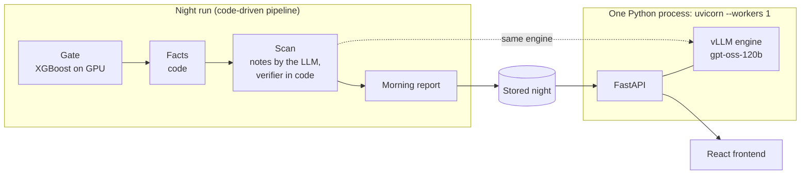

# TeleReason

TeleReason helps factories spot problems earlier. Overnight it scans robot-cell telemetry on one AMD Instinct MI300X and writes a morning report for maintenance technicians; a nightly gate checks what the data supports, so it reports verified facts, not guesses. During the day a live assistant answers technicians' questions from the same night, finds maintenance protocols and refuses requests to act on equipment.

Built by Team CSAIDev for the AMD Developer Hackathon ACT III, Track 1: Intelligent Industry.

- Demo: to be added
- Video: to be added

## What it does

- **Morning report.** One section per line with the windows a technician should look at first, the signal to check first and a short note. Every note is checked by code against the facts; a note that did not pass is not shown, only the facts.
- **Gate verdicts.** Each night the gate decides what the data of each line can support, and every response follows that verdict:
  - `closed`: no diagnosis, facts only. No fault name appears anywhere.
  - `screening`: the abnormal-behaviour score only, no cause.
  - `open`: diagnosis allowed.

  In the stored 11 Oct night, FactoryWave is `closed` (facts, not diagnosis) and AURSAD is `screening` (abnormal-behaviour screening only, no cause). Neither line is `open`.
- **Window page.** For one window: the facts per signal (window mean against the normal mean, the difference, the z-value and a plain reading), the signal to look at first, and the note with whether it passed the verifier.
- **Assistant.** A tool-calling assistant over five narrow tools (`get_report`, `list_windows`, `get_window`, `classify_fault`, `search_protocols`), at most four tool calls per question. The answer streams the tool calls as they happen. On a fault question the answer is written by code from the tool result, following the gate verdict; a request to start, stop or change equipment is refused before the model runs. Example questions are in Turkish and English.
- **AMD panel.** The GPU, the software versions and the measured step durations of the stored night.

The API contract is [docs/api.md](docs/api.md).

## Architecture



- The night run is code, not an agent, and runs in a fixed order: gate, facts, scan (notes and verifier), report. The 11 Oct night was run in this order on one MI300X; its results are stored in `fixtures/`. The night pipeline code is not in this repository yet.
- FastAPI and the vLLM engine (gpt-oss-120b) run in the same process on one MI300X. The engine cannot be shared across processes, so uvicorn runs with one worker. The night scan and the live assistant share this engine; live questions are scheduled before night notes.
- FastAPI serves the built React frontend from the same origin.

| | Fake mode (`ENGINE=fake`, default) | Real mode (`ENGINE=vllm`) |
|---|---|---|
| Hardware | Any laptop, no GPU | One AMD Instinct MI300X |
| Model | A stand-in engine, no model | gpt-oss-120b in vLLM on ROCm |
| Night | Responses from `fixtures/` | `NIGHT_SOURCE=stored` (the default and for now the only value) serves the stored 11 Oct night from `fixtures/` |
| AMD panel | From `fixtures/system.json` | GPU from `rocm-smi` and the installed versions; timings of the stored night |

All tests run in fake mode.

## How to run

### One command (fake mode)

Needs Docker with Compose, on Windows, macOS or Linux.

```bash
docker compose up --build
```

Then open `http://localhost:8000`. The container serves the API and the built frontend; `http://localhost:8000/docs` lists the endpoints.

### Development (two processes)

Settings come from environment variables; `.env.example` lists them. `ENGINE` defaults to `fake`, so this mode needs no setup.

Backend:

```bash
cd backend
uv sync
uv run uvicorn telereason.api.main:app --reload
```

Serves `/api` on `http://localhost:8000`, answering from `fixtures/`.

Frontend:

```bash
cd frontend
npm install
npm run dev
```

Opens on `http://localhost:5173` and proxies `/api` to the backend above. See [frontend/DESIGN.md](frontend/DESIGN.md) for the UI conventions.

Checks: `uv run ruff check .` and `uv run pytest -q` in `backend/`; `npm run lint`, `npm run build` and `npm test` in `frontend/`.

### Real mode (one AMD Instinct MI300X)

The real engine runs on one MI300X droplet from AMD Developer Cloud, inside its vLLM ROCm container. Setup, model and data downloads, start and stop are in [infra/droplet.md](infra/droplet.md).

## Measurements

Every number here comes from a file in this repository.

The stored 11 Oct night on one AMD Instinct MI300X ([fixtures/report_latest.json](fixtures/report_latest.json)):

| Line | Verdict | Windows scanned | Windows flagged |
|---|---|---:|---:|
| AURSAD | `screening` | 4,068 | 1,879 (score threshold 0.9) |
| FactoryWave | `closed` | 3,354 | not scored (closed) |

Step durations of that night, run one after another (`timings_s`, rounded to 0.1 s):

| Gate (XGBoost on GPU) | Facts | Scan (notes and verifier) | Report | Total |
|---:|---:|---:|---:|---:|
| 461.5 s (7.7 min) | 81.8 s (1.4 min) | 1,020.0 s (17.0 min) | under 0.1 s | 1,565.5 s (26.1 min) |

Software on the MI300X ([fixtures/system.json](fixtures/system.json)): ROCm 7.2.3, vLLM 0.27.1, XGBoost 3.2.0, Python 3.12.

Source: `fixtures/report_latest.json` and `fixtures/system.json`, generated from the 11 Oct run on one AMD Instinct MI300X.

AURSAD screening at the threshold 0.9 ([docs/business-value.md](docs/business-value.md)): 68.8% of the windows labelled faulty and 3.9% of the normal windows are flagged. These are rates within each class on lab data, not a guarantee for a production line.

Live answer latency: measured in the final run, to be added.

## Data and licenses

This repository contains no datasets and no model weights; they are downloaded at setup time and stay outside the repository. `fixtures/` holds small example responses derived from FactoryBench.

To download the FactoryBench telemetry outside the repository:

```bash
cd backend
uv run python -m telereason.data.download
```

The destination is `DATA_DIR/factorybench` (`DATA_DIR` defaults to `./data`). Existing Hugging Face files are reused, and `HF_TOKEN` may be set for authenticated Hub access. Without downloaded data the API serves `fixtures/` only when `ENGINE=fake`.

Data and model used:

- **FactoryBench** (Hugging Face: `FactoryBench/FactoryBench`). Its card asks users to also cite AURSAD and voraus-AD.
- **AURSAD** (Zenodo record 4487073).
- **voraus-AD**.
- **gpt-oss-120b** (Hugging Face: `openai/gpt-oss-120b`), Apache 2.0.

License details are in [DATA_NOTICE.md](DATA_NOTICE.md) (informational, not legal advice).

## Path to production

This is a hackathon build. A real factory deployment will add:

- **SSO:** technicians will sign in with the plant's single sign-on instead of reaching an open demo URL.
- **Audit log:** every question, answer, tool call and refused action request will be written to an append-only audit log.
- **Postgres:** night runs, notes and reports will be stored in Postgres; this build serves a stored night from files.
- **Separate model server:** the engine will move to its own model server so the API and the model can be restarted and scaled independently.
- **Monitoring:** engine health, answer latency, night-run duration and failures will be monitored, with alerts to the maintenance team.

## Business value

On AURSAD the gate flags 68.8% of the windows labelled faulty and 3.9% of the normal ones at the threshold 0.9 (lab data, rates within each class); [docs/business-value.md](docs/business-value.md) shows what that means for the number of windows a technician reviews.

## License

The code is [MIT](LICENSE). The data, the `fixtures/` derived from it and the model keep their own licenses; see [DATA_NOTICE.md](DATA_NOTICE.md).
